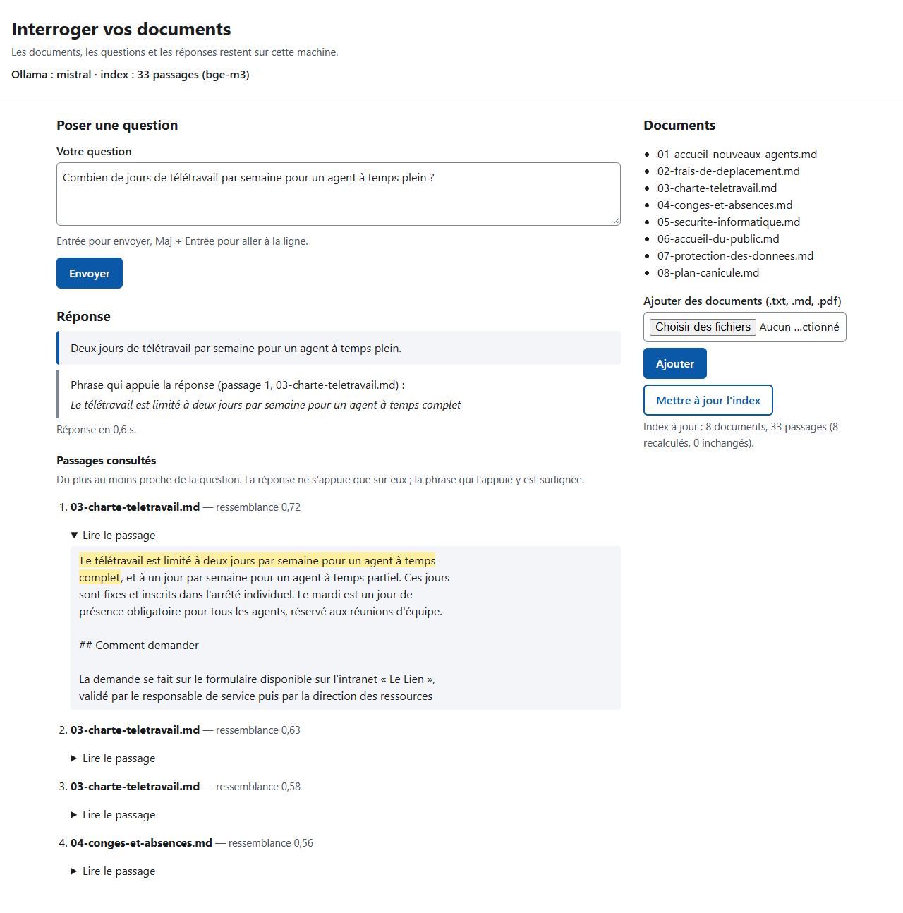

# RAG local souverain

[](https://github.com/LeoPeyreCosta/rag-local-souverain/actions/workflows/tests.yml)

**Interroger ses documents internes avec un modèle de langue qui tourne
entièrement sur sa machine, depuis une page web ou en ligne de commande.**

Cas d'usage : un service (mairie, établissement de santé, cabinet, PME) veut
poser des questions en langage courant sur ses procédures internes, notes de
service et guides, **sans envoyer ces documents dans le cloud**. Le programme
retrouve les passages utiles (RAG : *retrieval-augmented generation*) et les
donne à un modèle local, qui rédige la réponse en s'appuyant sur eux
seulement.

## Exemple (réponses réelles)

Sur le corpus d'évaluation (huit documents internes d'une commune fictive),
avec mistral 7B et bge-m3 :

```text
Question : Combien de jours de télétravail par semaine pour un temps plein ?
Réponse  : Deux jours par semaine pour un agent à temps plein.          (0,9 s)
Appui    : « Le télétravail est limité à deux jours par semaine pour un
           agent à temps complet » (03-charte-teletravail.md)

Question : Quel est le montant de la prime de Noël ?
Réponse  : Je ne trouve pas cette information dans les documents.       (0,3 s)

Question : Combien de jours de congé pour le mariage de mon frère ?
Réponse  : Cinq jours ouvrables.                                        (0,6 s)
Appui    : « Mariage ou PACS de l'agent : cinq jours ouvrables »
           (04-conges-et-absences.md)
```

La troisième réponse est fausse : les documents ne prévoient rien pour le
mariage d'un frère. La vérification ne la signale pas, puisque la phrase
citée existe bel et bien ; mais elle affiche « de l'agent », et l'erreur se
voit en une ligne. C'est le rôle de l'appui : rendre la vérification
rapide, pas la remplacer.

Dans la page web, la réponse s'écrit au fil de l'eau ; la phrase qui
l'appuie s'affiche dessous et est surlignée dans son passage, déplié
automatiquement. Une réponse sans appui retrouvé est signalée « non
vérifiée », un refus est affiché comme tel. La page liste aussi les
documents, permet d'en ajouter et de mettre l'index à jour.



## Fonctionnement

```text
  Page web (HTML, CSS, JS sans bibliothèque)        Ligne de commande
        │  question                                        │
        ▼                                                  ▼
  API FastAPI (127.0.0.1:8000) ─────────────── rag_local ────────────────
        │
        ├─► vecteur de la question ──► Ollama (bge-m3)        [GPU local]
        │
        ├─► 4 passages les plus proches dans l'index (index.json, cosinus)
        │
        ├─► consigne + passages + question ──► Ollama (mistral) [GPU local]
        │
        └─► « recopie la phrase qui justifie ta réponse » ──► Ollama (mistral)
              puis le code cherche cette citation dans les 4 passages
                                                     │
          réponse en flux NDJSON : passages, texte, appui (trouvé ?), fin (refus ?)

  ── Tout le trafic reste sur la machine (127.0.0.1:11434 et 127.0.0.1:8000). ──
```

- **Index incrémental.** Chaque document est découpé en passages d'environ
  500 caractères qui se chevauchent. L'index garde l'empreinte de chaque
  document : une mise à jour ne recalcule que les documents nouveaux ou
  modifiés.
- **Les sources viennent de la recherche, pas du modèle.** Un modèle de 7
  milliards de paramètres numérote mal ses références ; le programme affiche
  donc lui-même les passages consultés, dans l'ordre de la recherche.
- **Un refus reconnaissable.** Quand les extraits ne contiennent pas la
  réponse, la consigne impose une phrase fixe (« Je ne trouve pas cette
  information dans les documents. »), que le code reconnaît, ainsi que ses
  reformulations courantes.
- **Une phrase des documents à l'appui de chaque réponse.** Une fois la
  réponse écrite, le modèle doit recopier la phrase des passages qui la
  justifie. Le code la cherche dans les passages, mot à mot, à quelques
  différences près (ressemblance d'au moins 0,8, au moins 4 mots) : le
  modèle recopie rarement à la lettre. Une citation qui assemble des
  phrases non contiguës d'un même passage est vérifiée phrase par phrase.
  Retrouvée, c'est **le texte du document** qui est affiché et surligné
  dans son passage, pas la copie du modèle (une citation où le modèle a
  écrit « 110 euros » au lieu de « 90 euros » montre bien « 90 euros »).
  Introuvable, la réponse est signalée comme non vérifiée. La demande est
  posée à la suite de la réponse, dans le même échange : Ollama réutilise
  les passages déjà lus (0,01 s de lecture au lieu de 0,2 s mesurées dans
  un échange séparé). Une citation retrouvée prouve que la phrase existe,
  pas que la réponse en découle (voir l'évaluation).

## Souveraineté : les garanties

- **Aucun appel externe.** Le programme ne parle qu'au serveur Ollama
  (`http://127.0.0.1:11434`), et la page ne charge aucune ressource
  extérieure (pas de police, de bibliothèque ni de statistique en ligne ;
  un test le vérifie).
- **Fonctionne hors ligne.** Une fois les modèles téléchargés, l'indexation
  et les questions n'ont pas besoin d'Internet. Pour le vérifier : couper le
  réseau et poser une question ; ou surveiller le trafic (pare-feu,
  Wireshark).
- **Accès local par défaut.** Le serveur web écoute sur `127.0.0.1` :
  seule la machine elle-même y accède. Il n'y a pas d'authentification ;
  l'ouvrir au réseau (`--hote 0.0.0.0`) donne accès aux documents à toute
  personne qui atteint la machine, et le programme le rappelle au démarrage.
- **Les données restent chez soi.** Documents, index et réponses ne sont
  écrits que sur le disque local ; le `.gitignore` exclut `docs/` et
  `index.json`, qui contient le texte des documents.

## Évaluation

Huit documents internes d'une commune fictive (accueil des agents, frais de
déplacement, télétravail, congés, sécurité informatique, accueil du public,
protection des données, plan canicule) et des questions d'agents annotées
(voir [`corpus/README.md`](corpus/README.md)). Pour chaque question, on
mesure :

- **la recherche** : le passage qui contient la réponse arrive-t-il en tête,
  ou au moins parmi les 4 passages donnés au modèle ?
- **la réponse** : juste, refus à tort (« je ne trouve pas » alors que
  l'information est là), ou fausse ; et pour les questions dont la réponse
  n'est **pas** dans les documents : refus correct, ou réponse inventée ;
- **l'appui** : pour une réponse juste, une phrase des passages a-t-elle été
  retrouvée, et contient-elle la preuve annotée ? Une réponse fausse ou
  inventée est-elle signalée « non vérifiée » ?

Trois jeux de questions : `developpement/` (40 questions, dont 6 sans
réponse) a servi à la mise au point ; `controle/` (21 questions, dont 5 sans
réponse) a été écrit et versé après le gel du code (commit `ca44386`) ;
`controle-2/` (27 questions, dont 6 sans réponse), sur des faits qu'aucune
autre question n'interroge, a été versé (commit `036aaf6`) avant d'écrire la
vérification par citation et avant toute mesure. Les tableaux sont ceux du
code actuel, modèles rechargés avant chaque jeu.

### Recherche

| Embeddings | Développement : en tête / parmi les 4 | Contrôle | Second contrôle |
|---|---|---|---|
| nomic-embed-text (version précédente) | 17/34, 27/34 | 7/16, 12/16 | 10/21, 20/21 |
| **bge-m3 (retenu)** | 30/34, **34/34** | 14/16, **16/16** | 17/21, **21/21** |

La version précédente de ce dépôt utilisait `nomic-embed-text`, entraîné
surtout sur de l'anglais : pour 7 questions de développement sur 34, le
passage utile n'était même pas transmis au modèle. `bge-m3`, multilingue, le
transmet à chaque fois.

### Réponses (mistral 7B)

| Embeddings, jeu | Questions avec réponse : justes | Refus à tort | Questions sans réponse : refus correct | Réponses inventées |
|---|---|---|---|---|
| nomic-embed-text, développement | 27/34 | 4 | 6/6 | 0 |
| nomic-embed-text, contrôle | 13/16 | 2 | 5/5 | 0 |
| nomic-embed-text, second contrôle | 20/21 | 0 | 5/6 | 1 |
| **bge-m3, développement** | **34/34** | 0 | 5/6 | 1 |
| **bge-m3, contrôle** | **16/16** | 0 | 5/5 | 0 |
| **bge-m3, second contrôle** | **21/21** | 0 | 4/6 | 2 |

Environ 0,5 seconde par question (recherche et réponse) sur une RTX 3080,
plus 0,6 seconde pour la vérification par citation.

- **Avec bge-m3, toutes les réponses présentes dans les documents sont
  trouvées** (71 sur 71, les trois jeux réunis), contre 60 sur 71 avec
  nomic-embed-text, dont les échecs viennent surtout de passages utiles
  jamais transmis au modèle.
- **Le risque d'extrapolation demeure**, et le second contrôle le montre
  mieux que les deux premiers jeux : 2 réponses inventées sur 6 questions
  sans réponse, contre 1 sur 11 auparavant. Ses questions sans réponse
  frôlent des faits présents : « Combien de jours de congé pour le mariage
  de mon frère ? » → « Cinq jours ouvrables » (c'est le mariage de l'agent) ;
  « Puis-je lire mes courriels professionnels sur mon téléphone personnel ?
  » → « Non… ». La recherche fournit des passages proches du sujet, et un
  modèle de 7 milliards de paramètres en tire une conclusion que les
  documents ne donnent pas.
- **bge-m3 est gardé par défaut** : manquer 11 réponses sur 71 qui sont
  dans les documents rend l'outil inutile pour l'agent.

### Vérification par citation (bge-m3)

| Jeu | Réponses justes appuyées | dont appui contenant la preuve | Réponses fausses ou inventées signalées |
|---|---|---|---|
| Développement | 33/34 | 32/33 | 0/1 |
| Contrôle | 15/16 | 14/15 | aucune à signaler |
| Second contrôle | 20/21 | 17/20 | 0/2 |

- **La phrase affichée est presque toujours là** : 68 réponses justes sur
  71 ont un appui retrouvé, qui contient 63 fois sur 68 la phrase de preuve
  annotée. Les autres fois, c'est la phrase voisine (pour l'assurance sans
  ordre de mission signé : « L'usage du véhicule personnel doit être
  autorisé sur l'ordre de mission ») ou un morceau de la bonne phrase.
- **Peu de fausses alertes** : 3 réponses justes sur 71 sont signalées
  « non vérifiées », parce que le modèle a récrit sa citation (« l'agent
  préviendra » pour « l'agent prévient », « Le maire décide de déclencher »
  pour « Le plan est déclenché par le maire ») ou l'a composée avec des
  phrases d'autres documents.
- **Ce que la vérification ne fait pas : repérer une réponse inventée.**
  Les 3 réponses inventées citent toutes une phrase réelle (« Mariage ou
  PACS de l'agent : cinq jours ouvrables »). Une citation retrouvée prouve
  que la phrase existe, pas que la réponse en découle. L'intérêt est de
  mettre cette phrase sous les yeux de l'agent : l'écart entre « de
  l'agent » et « de mon frère » se voit d'un coup d'œil.
- Avec nomic-embed-text : 58 réponses justes appuyées sur 60, et 1 réponse
  erronée signalée sur 6.

**Mesure avant correction, puis corrections.** La première mesure du code
de vérification (commit `5172cad`) donnait 32/34, 15/16 et, sur le second
contrôle, seule mesure indépendante, 18/21 réponses justes appuyées et 3/6
refus corrects. Deux défauts sont apparus, corrigés ensuite (commit
`8b4b152`) :

- le modèle assemble parfois des phrases non contiguës d'un même passage
  (la première et la troisième ; 3 fois sur les trois jeux) : chaque phrase
  est maintenant cherchée à part, et le surlignage va de la première à la
  dernière ;
- « Le numéro à appeler … n'est pas spécifié dans les documents fournis »
  n'était pas reconnu comme un refus, et comptait comme une réponse
  inventée.

Ces corrections ont été faites après avoir vu le second contrôle : les
chiffres d'après ne sont plus une mesure indépendante.

**Ce qui a changé pendant la mise au point.**

- La détection du refus ne reconnaissait d'abord que la phrase imposée ; le
  modèle dit parfois la même chose avec ses mots (« La cantine du personnel
  n'est pas mentionnée dans les extraits »), ce qui était compté à tort comme
  une réponse inventée. Quelques tournures précises sont maintenant
  reconnues ; un test vérifie qu'une simple négation (« les amendes ne sont
  pas remboursées ») n'est pas prise pour un refus.
- Le recouvrement entre deux passages voisins repartait du premier mot
  venu : un passage pouvait commencer par « jours », fin d'un titre coupé.
  Il repart maintenant d'un début de ligne quand il y en a un. Mesures avec
  l'ancien découpage (34 passages au lieu de 33) : bge-m3 en tête 31/34 et
  15/16, réponses justes 34/34 et 16/16, refus corrects 5/6 et 3/5 ;
  nomic-embed-text réponses justes 26/34 et 15/16.
- **Le temps par question est passé de 4,7 s à 0,5 s** en joignant Ollama
  sur `127.0.0.1` au lieu de `localhost`. Sous Windows, `localhost` essaie
  d'abord l'IPv6 (`::1`), où Ollama n'écoute pas, et chaque connexion perdait
  environ 2 secondes ; une question en ouvre deux (vecteur, réponse). Le
  découvrir a demandé de mesurer le temps passé dans Ollama (0,5 s pour la
  citation) et de le comparer au temps total (2,9 s).
- À température 0, les réponses varient encore légèrement d'un passage à
  l'autre : sur le développement, avec nomic-embed-text, une question passe
  de « fausse » à « refus à tort » entre deux mesures.

## Accessibilité

La page vise les règles d'accessibilité attendues d'un service public
(RGAA) :

- lien d'évitement vers la question, structure de titres sans saut,
  étiquette visible pour chaque champ, navigation complète au clavier et
  focus visible ;
- la réponse est annoncée aux lecteurs d'écran une fois complète, et non
  morceau par morceau pendant qu'elle s'écrit, avec la phrase qui l'appuie
  ou l'avertissement « réponse non vérifiée » ; le surlignage n'est pas le
  seul signal (la phrase est aussi recopiée en toutes lettres sous la
  réponse) ;
- contrastes d'au moins 4,5:1 pour le texte et 3:1 pour les bordures, en
  thème clair comme en thème sombre (suivi des préférences du système) ;
  animations désactivées si l'utilisateur le demande.

Ces points sont contrôlés automatiquement
([`tests/test_accessibilite.py`](tests/test_accessibilite.py)). Ces contrôles
ne remplacent pas un audit : la page n'a pas été testée avec un lecteur
d'écran.

## Installation

Prérequis : Python 3.10 ou plus récent, [Ollama](https://ollama.com).

```sh
git clone https://github.com/LeoPeyreCosta/rag-local-souverain.git
cd rag-local-souverain
python -m pip install -e .
ollama pull mistral     # modèle de langue (4,4 Go)
ollama pull bge-m3      # embeddings multilingues (1,2 Go)
rag-local verifier
```

## Utilisation

```sh
# Interface web : http://127.0.0.1:8000
rag-local serveur

# En ligne de commande : déposer ses documents (.txt, .md, .pdf) dans docs/, puis
rag-local indexer
rag-local demander "Combien de jours de congés pour un mariage ?"

# Essayer sur le corpus d'exemple
rag-local serveur --documents corpus/documents

# Mesurer la recherche, les réponses et leur appui
rag-local evaluer --questions corpus/controle-2/questions.jsonl --details
rag-local evaluer --questions corpus/controle-2/questions.jsonl --sans-appui   # sans la citation
```

Réglages par variables d'environnement : `LLM_MODEL` (défaut `mistral`),
`EMBED_MODEL` (défaut `bge-m3`), `OLLAMA_URL`, `RAG_DOCUMENTS`, `RAG_INDEX`.
Changer de modèle d'embeddings impose de réindexer ; le programme le signale.

## Stack

| Élément | Choix | Pourquoi |
|---|---|---|
| Serveur de modèles | Ollama | local, simple, tourne sur la carte graphique |
| Modèle de langue | mistral 7B (quantifié) | bon en français, tient dans 10 Go de mémoire graphique |
| Embeddings | bge-m3 | multilingue ; voir l'évaluation |
| Recherche | Python pur (cosinus) | quelques milliers de passages : une base vectorielle n'apporte rien |
| API web | FastAPI, uvicorn | flux de réponse, dépôt de fichiers, peu de code |
| Page | HTML, CSS, JavaScript sans framework | rien à télécharger, rien à compiler, fonctionne hors ligne |
| Lecture PDF | pypdf | texte des PDF numériques |

## Quel matériel pour faire tourner ça ?

**La règle :** les modèles doivent tenir dans la mémoire de la carte
graphique. Ici, `mistral` 7B quantifié pèse environ 4,4 Go et `bge-m3`
1,2 Go : une carte de 8 Go devrait suffire pour un utilisateur (non testé).
Plus de mémoire permet des modèles plus gros ou plusieurs utilisateurs
simultanés.

| Usage | Matériel type | Mémoire | Prix indicatif | Ce que ça permet |
|---|---|---|---|---|
| Découverte | PC existant, sans carte graphique (16 Go de RAM) | — | 0 € | Fonctionne sur le processeur, mais nettement plus lent (non mesuré ici) |
| Poste individuel | RTX 3060 12 Go | 12 Go | carte ~300–350 € · PC complet ~900–1 200 € *(estimation)* | Modèles 7–8B à l'aise |
| Poste confortable | RTX 5060 Ti 16 Go | 16 Go | carte ~450–600 € · PC complet ~1 100–1 500 € *(estimation)* | Modèles 7–14B |
| **Machine de test** | **RTX 3080 10 Go** | 10 Go | — | **Mesuré : environ 0,5 s par question, plus 0,6 s pour la citation** (mistral 7B, réponses courtes) |
| Petite équipe | RTX 3090 24 Go d'occasion | 24 Go | carte ~800–1 200 € d'occasion, très variable | Modèles 14–32B, plusieurs utilisateurs (avec un serveur adapté comme vLLM) |
| Alternative silencieuse | Mac mini M4 Pro 48 Go | 48 Go unifiée | ~2 900–3 200 € | Gros modèles, faible consommation (non testé ici) |

Au-delà (service pour toute une structure, dizaines d'utilisateurs) :
serveur équipé de cartes professionnelles, sur devis.

> **Prix relevés mi-novembre 2026** chez des revendeurs français. Le marché
> est tendu (pénurie de mémoire en 2026) : les prix varient fortement, à
> revérifier avant tout achat. Les prix de PC complets sont des estimations,
> pas des relevés.

## Limites

- **Le modèle peut conclure au-delà des documents** (3 réponses inventées
  sur 17 questions sans réponse, voir l'évaluation), et la vérification par
  citation ne le repère pas : elle montre la phrase sur laquelle la réponse
  s'appuie, que l'agent doit lire.
- **Corpus d'évaluation petit et fictif** : 8 documents courts (33
  passages) et 88 questions, écrits par l'auteur. Sur une vraie base
  documentaire, plus grande et plus redondante, la recherche aura plus de
  passages proches à départager.
- **Un seul modèle de langue mesuré** (mistral 7B). Un modèle plus gros
  extrapolerait sans doute moins, au prix du temps et de la mémoire.
- **Pas d'authentification ni de droits par document** : outil local pour
  un poste, pas un service partagé.
- **PDF** : seul le texte numérique est lu ; un document scanné doit d'abord
  passer par une reconnaissance de caractères.
- **Accessibilité** contrôlée automatiquement, pas auditée (voir plus haut).

## Structure

```text
src/rag_local/
  config.py       réglages (variables d'environnement)
  documents.py    lecture des .txt, .md, .pdf et découpage en passages
  ollama.py       embeddings et réponse en flux via Ollama
  index.py        index incrémental, recherche par similarité cosinus
  reponse.py      consigne, refus reconnu, recherche, réponse, citation retrouvée
  web.py          API FastAPI
  static/         page HTML, CSS, JavaScript
  evaluation.py   mesure de la recherche, des réponses et de leur appui
  __main__.py     ligne de commande rag-local
tests/            tests unitaires, API et accessibilité (sans GPU ni Ollama)
corpus/           documents fictifs, questions annotées, guide
docs/             vos documents (non versionnés)
```

## Tests et qualité

```sh
python -m pip install -e ".[dev]"
python -m pytest --cov
```

68 tests, sans GPU ni réseau : un faux client remplace Ollama. Ils couvrent
l'index incrémental, la recherche, la reconnaissance du refus, la
recherche de la citation (recopie imparfaite, phrases non contiguës,
citation introuvable ou illisible), l'API web
(flux de réponse, dépôt de fichiers, noms de fichiers assainis),
l'accessibilité de la page, la ligne de commande, et le contrat avec Ollama
(requêtes d'embeddings par lots, lecture du flux de réponse, réponse
contrainte par un schéma JSON, erreur signalée en cours de flux). La CI (Python 3.10 à 3.13) exécute aussi une
analyse statique (pyflakes), une vérification des types (mypy) et exige au
moins 85 % de couverture (96 % aujourd'hui).

## Projets liés

Quatre outils d'IA locale, construits et évalués de la même façon (corpus
fictifs annotés, corpus de contrôle versé avant la mesure) :

- [pseudonymisation-locale](https://github.com/LeoPeyreCosta/pseudonymisation-locale) :
  masquer les données personnelles d'un document ;
- [tri-demandes-local](https://github.com/LeoPeyreCosta/tri-demandes-local) :
  orienter les demandes d'usagers d'une mairie et repérer les urgences ;
- [compte-rendu-local](https://github.com/LeoPeyreCosta/compte-rendu-local) :
  transcrire une réunion et en rédiger le compte rendu ;
- rag-local-souverain (ce dépôt).

## Licence

MIT
